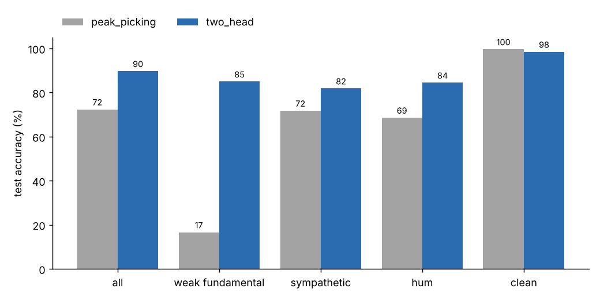
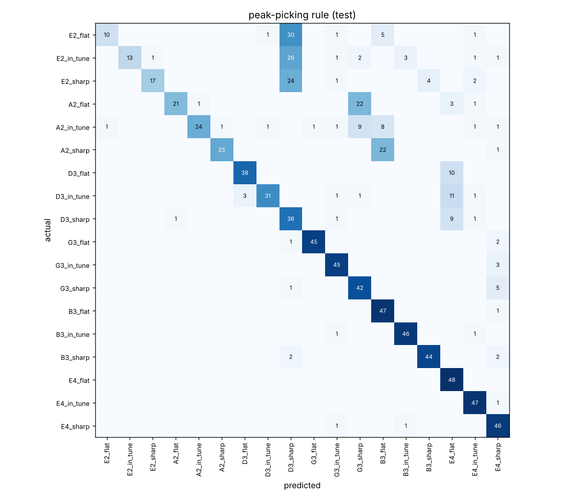
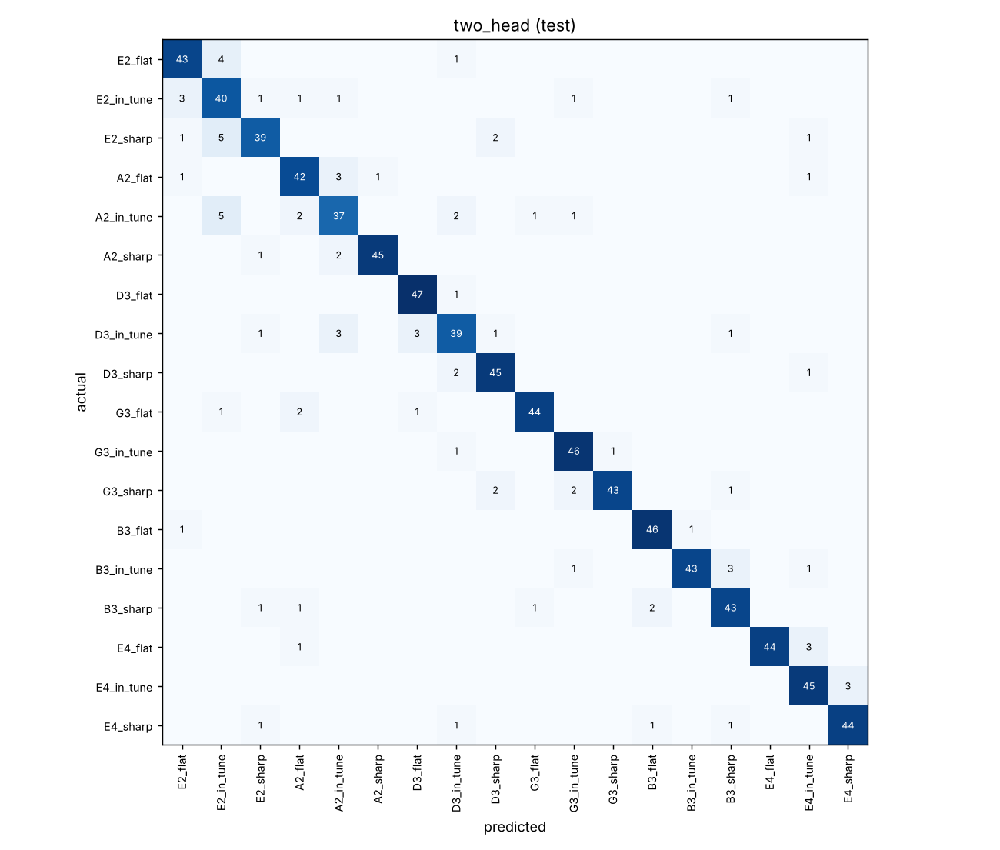

# strumnet

[](https://github.com/NicolasPazz/strumnet/actions/workflows/ci.yml)

A guitar tuner that doesn't fall for octave errors.

Most tuner apps grab the loudest peak in the spectrum and assume it's the fundamental. That's fine until a phone mic rolls off the low end. On the low E and A strings the 2nd harmonic often ends up louder than the fundamental, the tuner locks onto it, and you get told you're playing a very sharp G3 when you're actually a slightly flat A2.

strumnet looks at 12 spectral features instead of one peak and classifies each note as **string x state** (6 strings x flat / in tune / sharp) with a tiny MLP, around 400 weights. On the test set it's right about 90% of the time against 72% for peak picking, and almost all of that gap comes from the hard cases: when the fundamental is weak, peak picking gets 17% and the model 85%.



```console
$ strumnet render A2 -25 a2_flat.wav --seed 2
wrote a2_flat.wav (weak fundamental)
$ strumnet predict models/two-head a2_flat.wav
a2_flat.wav: A2 flat (-25 cents, p=0.90) | peak at 216.9 Hz, peak picking says G3 sharp
```

## Quick start

```bash
git clone https://github.com/NicolasPazz/strumnet
cd strumnet
python -m venv .venv
source .venv/bin/activate        # Windows: .venv\Scripts\activate
pip install -e ".[train]"
```

Then:

```bash
strumnet render E2 0 e2.wav               # synthetic note: string, detune in cents, output
strumnet predict models/two-head e2.wav   # bundled model, works on any PCM WAV
```

`predict` reads 8 to 32-bit PCM, mono or stereo, any sample rate. It resamples to 8 kHz, finds the attack and analyses the 0.5 s right after it.

To rebuild everything from scratch:

```bash
strumnet generate                              # data/guitar_notes.csv (seed 42, same file as the committed one)
strumnet train --two-heads --out models/two-head
python experiments/benchmark.py                # tables in results/, figures in docs/img/
```

The generator only needs NumPy (`pip install -e .`). Training and the benchmark need the `train` extra (TensorFlow, scikit-learn, pandas, matplotlib).

## How it works

### 1. Synthetic data

There's no dataset of out-of-tune guitars recorded through phone mics with exact labels, so `strumnet.synth` renders one. Each example is a 0.5 s window at 8 kHz of:

- a plucked string with up to 10 partials, with timbre set by the pluck position and a random spectral tilt
- inharmonicity, `f_n = n * f0 * sqrt(1 + B n^2)`, like real strings
- exponential decay (upper partials die first), windowed at a random point of the note
- a phone-mic high-pass with a random cutoff between 70 and 220 Hz
- sympathetic resonance from another open string (35% of examples)
- white noise at one of four levels, plus mains hum and fan rumble (30% of examples)

Labels come from the true pitch. Features only see the rendered signal. A note counts as in tune within ±10 cents and goes up to ±50 cents otherwise.

### 2. Features

Twelve per window, from a Hann-windowed, zero-padded FFT:

| feature | what it is |
| --- | --- |
| `f0_hz` | strongest peak in 60 to 1200 Hz, parabolic interpolation (what a classic tuner uses) |
| `cents_dev` | cents off the nearest open string |
| `h1_rel_amp`, `h2_rel_amp` | energy at 2·f0 and 3·f0 relative to the peak |
| `energy` | mean signal power |
| `bandwidth_hz` | spread of energy around the peak |
| `cents_note` | cents off the nearest chromatic note, any octave |
| `sub2_rel_amp`, `sub3_rel_amp` | energy at f0/2 and f0/3 relative to the peak |
| `peak2_hz`, `peak2_rel_amp` | second strongest peak and its relative level |
| `centroid_hz` | spectral centroid |

The first six are what a peak-picking tuner already has. The last six are the ones that catch octave errors: if there's a lot of energy at f0/2 and the second peak sits an octave below, the "fundamental" is really a harmonic. `cents_note` keeps the tuning information either way, since a harmonic an octave up has the same pitch class.

### 3. Model

Standardized features into `Dense(16, relu) -> Dense(8, relu)` and then either one 18-way softmax or two heads (string and state). Adam, batch 32, early stopping on validation loss with patience 25. The bundled model is the two-head one: it's the smallest and gives you string and state separately.

## Results

Test set: 864 examples, 48 per class. Split 60/20/20, stratified by class and noise level.

| model | topology | params | test acc | string | state | train-test gap |
| --- | --- | ---: | ---: | ---: | ---: | ---: |
| peak picking | - | - | 72.34 | 73.15 | 80.32 | - |
| base | 12 → 16 → 8 → 18 | 506 | 89.12 | 94.10 | 92.71 | 2.85 |
| wide | 12 → 32 → 16 → 8 → 18 | 1242 | 87.38 | 92.25 | 92.94 | 5.05 |
| dropout 0.2, lr 5e-3 | 12 → 16 → 8 → 18 | 506 | 90.05 | 92.48 | 95.14 | 1.27 |
| two heads | 12 → 16 → 8 → (6 + 3) | 425 | 89.70 | 94.79 | 93.29 | 2.55 |

Accuracy (%) on each slice of the test set. One example can have more than one difficulty.

| | peak picking | base | wide | dropout | two heads |
| --- | ---: | ---: | ---: | ---: | ---: |
| all | 72.34 | 89.12 | 87.38 | 90.05 | 89.70 |
| weak fundamental (259) | 16.60 | 83.40 | 83.01 | 83.78 | 84.94 |
| sympathetic resonance (308) | 71.75 | 82.14 | 78.25 | 81.82 | 81.82 |
| hum (296) | 68.58 | 82.09 | 81.42 | 86.49 | 84.46 |
| clean (260) | 99.62 | 97.69 | 97.31 | 99.23 | 98.46 |

A few things worth noting:

- More capacity doesn't help. `wide` has the lowest test accuracy and the biggest train-test gap.
- Dropout, two heads and base are within a point of each other, which is about 5 test examples. With a single seed per model I'd call them tied.
- On clean signals peak picking is basically perfect and slightly beats every model. The network earns its keep on the messy examples only, which suggests a hybrid (see below).
- StandardScaler beats MinMaxScaler (89.12 vs 87.50 for base, 87.38 vs 86.69 for wide). The relative-amplitude features have long tails when the fundamental almost disappears, and min-max squashes everything else towards zero. See `results/scaling.csv`.
- The low strings are still the hardest, for the obvious reason: E2 and A2 account for about half of the two-head model's errors.

<p>
  
  
</p>

Peak picking (left) sends a big chunk of E2 to D3 sharp, A2 to G3 sharp or B3 flat and D3 to E4 flat. Those are the octave errors: the harmonic an octave up lands closest to another string, way out of tune. Per-class precision/recall, accuracy by noise level and loss curves are in [`results/`](results) and [`docs/img/`](docs/img).

Numbers come from `python experiments/benchmark.py` with TensorFlow 2.21 on CPU. Other TF builds can move them by a few test examples.

## Dataset

[`data/guitar_notes.csv`](data/guitar_notes.csv): 4,320 examples, 240 per class, one row per window.

- 12 feature columns (above)
- `noise_level`, `weak_fundamental`, `sympathetic`, `hum`: how the example was made. Not model inputs, only for slicing results. About 30% of the examples have a weak fundamental, 36% sympathetic resonance and 30% hum. 31% have none of them.
- `string`, `state`, `label` (e.g. `A2_flat`) and `split` (train / val / test)

`strumnet generate --seed 42` reproduces it exactly, and there's a test that checks it.

## Layout

```
src/strumnet/
  tuning.py      strings, classes, cents helpers
  synth.py       note synthesis: partials, mic, resonance, noise
  features.py    the 12 spectral features
  dataset.py     generator and CSV I/O
  baseline.py    peak-picking rule
  model.py       Keras MLPs, training, saving
  evaluate.py    metrics, breakdowns, plots
  audio.py       WAV I/O, resampling, picking the analysis window
  inference.py   Tuner: load a model directory, classify signals or WAVs
  cli.py         the strumnet command
experiments/benchmark.py
tests/
```

## Limitations and next steps

- **It has only seen synthetic audio.** `predict` runs on real recordings, but I don't have numbers for real guitars yet, and `energy` depends on input level. A small labelled set of real recordings is the next thing to add.
- **The baseline is the simplest possible tuner.** HPS and YIN were designed to avoid octave errors and are the fair comparison.
- **Hybrid.** Use peak picking when the spectrum looks clean and the model otherwise, to keep the 99.6% on clean notes.
- Several seeds per model, to see whether the 1-point differences are real.
- Two heads plus dropout, and a small CNN over the full spectrum instead of hand-made features.
- Live mic input.

## License

[MIT](LICENSE)
